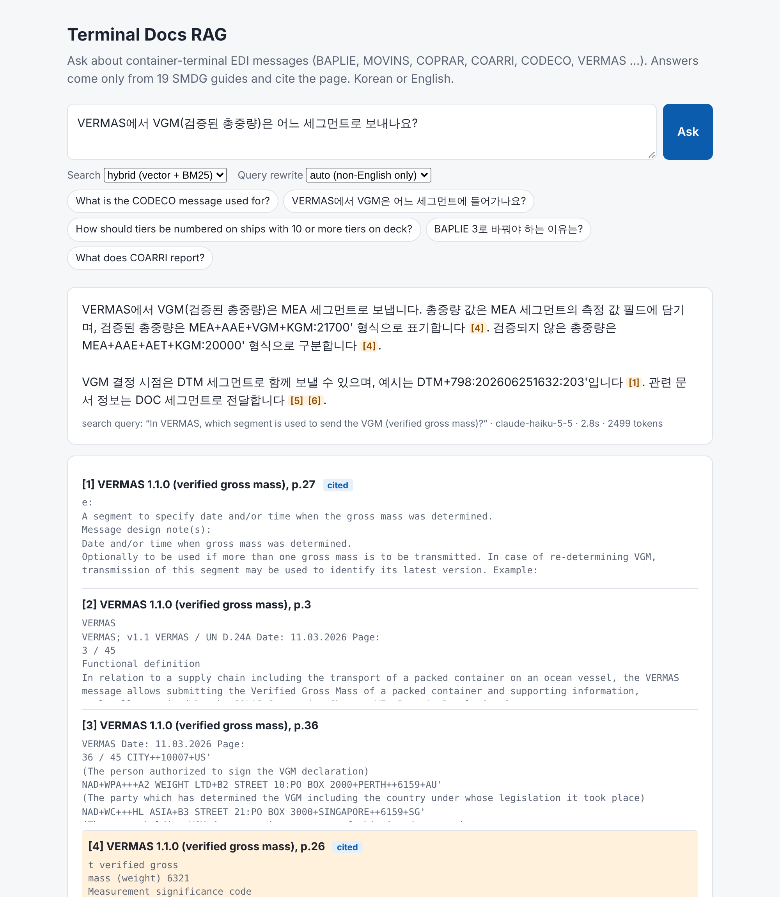

# Terminal Docs RAG

**Ask questions about container-terminal EDI messages in Korean or English, and get answers that cite the exact document and page.**

The knowledge base is 19 public SMDG guides (830 pages) for the EDIFACT messages that terminals and shipping lines exchange every day: BAPLIE, MOVINS, COPRAR, COARRI, COPARN, CODECO, COREOR, COPINO, VERMAS, IFTSTA, TPFREP, DESTIM, plus six SMDG recommendations. It is a small version of an internal "search our technical documents" assistant, built and **measured** on a 35-question test set.



## Results

Test set: 29 questions with a known answer page (21 English, 8 Korean) and 6 questions whose answer is **not** in the documents (the assistant should say so, not guess). Answers were graded by a separate model (Claude Opus 5.5) against reference facts written from the documents.

| Setup | Correct | Partial | Wrong | English | Korean | "Not in documents" handled | Median time |
|---|---:|---:|---:|---:|---:|---:|---:|
| **Haiku 5.5, hybrid search, rewrite non-English** (default) | **27/29** | 1 | 1 | 19/21 | **8/8** | **6/6** | 1.7 s |
| Sonnet 5.5, same retrieval | 27/29 | 1 | 1 | 19/21 | 8/8 | 6/6 | 3.4 s |
| Haiku 5.5, no query rewrite | 21/29 | 2 | 6 | 19/21 | 2/8 | 6/6 | 1.6 s |

- **The cheaper model is enough.** Haiku matched Sonnet on every question here, at half the latency. With good retrieval, the answer model mattered less than the search step.
- **Query rewriting is what makes Korean work** (2/8 → 8/8). The embedding model and the documents are English. Korean questions are first translated into an English search query by a short LLM call.
- **No made-up answers.** All 6 out-of-scope questions (e.g. the CATOS EDI server port, Busan terminals that require BAPLIE 3.1) were refused. When retrieval missed, the model said "the excerpts do not state this" instead of guessing. All 5 wrong Korean answers in the no-rewrite run were refusals of this kind.
- In 28 of 29 answers, a citation points to the correct page.
- Average cost per question: about 2,100 input and 220 output tokens.

### Retrieval: which search finds the right page?

Page-level hit@6 (a gold page is among the 6 chunks given to the model) and MRR@10, on the 29 answerable questions:

| Query | Search | All | English | Korean |
|---|---|---:|---:|---:|
| as typed | vector only | 69% / 0.53 | 95% / 0.73 | 0% / 0.01 |
| as typed | BM25 only | 79% / 0.53 | 90% / 0.61 | 50% / 0.31 |
| as typed | hybrid | 76% / 0.57 | 95% / 0.73 | 25% / 0.17 |
| rewritten (all) | BM25 only | 100% / 0.74 | 100% / 0.77 | 100% / 0.65 |
| rewritten (all) | hybrid | 97% / 0.72 | 95% / 0.74 | 100% / 0.69 |
| **rewritten if not English** | **hybrid** | **97% / 0.72** | **95% / 0.73** | **100% / 0.69** |
| original + rewritten, fused | hybrid | 86% / 0.64 | 95% / 0.73 | 62% / 0.40 |

The default ("rewrite only non-English, hybrid") skips the extra LLM call for English questions. On this small set, rewriting everything with BM25 alone found one more page. With 29 questions that is a one-question difference, too small to call.

## What went wrong along the way (and the fix)

1. **Header removal deleted table values.** Running headers are detected as lines that repeat on most pages. In EDIFACT tables, single cells like `M`, `C`, `1` or `9999` also repeat on most pages, and were being deleted. Fix: only lines with at least 10 characters and some real words count as headers.
2. **The query rewriter "helped" too much.** The first rewrite prompt padded queries with extra message names. English retrieval with vector search fell from 95% to 71%, and *DESTIM* was expanded into "DESTINATION TERMINAL MESSAGE", which is wrong. Fix: the prompt now only translates and keeps codes the question itself names, and English questions skip the rewrite. Lesson: an LLM step in a pipeline needs its own measurement.
3. **Empty answers.** With extended thinking on, a model could spend the whole `max_tokens` budget thinking and return no text. Models also differ in how thinking is switched off. `rag/llm.py` handles both.

## How it works

```
PDF ─► page text ─► remove running headers ─► ~900-char chunks (doc + page kept)
                                                   │
                         all-MiniLM-L6-v2 (ONNX) ──┼──► Chroma (cosine)      ┐
                                         BM25 ─────┴──► keyword index         ├─ reciprocal rank fusion ─► top 6
question ─► (Korean? → Claude rewrites to English query + EDIFACT keywords) ──┘
                                                                              ▼
                 Claude answers ONLY from the 6 excerpts, cites [n], says so when the answer is missing
```

- **Chunks** carry their document title ("CODECO 2.1.3 …") so a chunk from the middle of a table still says which message it belongs to.
- **Hybrid search**: vector search finds meaning ("who sends the stowage plan"); BM25 finds exact codes (`EQD`, `MEA+AAE+VGM`, `3055`). The two rankings are merged with reciprocal rank fusion.
- **Embeddings run locally** on CPU with onnxruntime (no PyTorch, no API), so the document index never leaves the machine. Only the question and the 6 retrieved excerpts go to the LLM.

## Run it

```bash
pip install -r requirements.txt
python scripts/fetch_data.py          # 19 PDFs from smdg.org + embedding model, SHA-256 checked
python -m rag.ingest && python -m rag.index
cp .env.example .env                  # add ANTHROPIC_API_KEY
uvicorn app.main:app --port 8000      # web page: http://localhost:8000  ·  API docs: /docs
```

Or with Docker (after `fetch_data.py`): `docker compose up --build`. The index is built on first start.

**API**

| Endpoint | |
|---|---|
| `POST /ask` | `{"question": "...", "mode": "hybrid", "rewrite": "auto"}` → answer, sources with page numbers, which were cited, tokens, time |
| `GET /search?q=...` | retrieval only, no LLM or key needed |
| `GET /health` | status and number of indexed chunks |

**Tests and evaluation**

```bash
pytest -q                                          # 9 tests, LLM replaced by a fake client
python -m eval.run_eval retrieval --no-llm         # retrieval only, no API key
python -m eval.run_eval retrieval                  # all rewrite policies × search modes
python -m eval.run_eval answers --model claude-haiku-5-5 --judge claude-opus-5-5
```

The questions and reference facts are in `eval/questions.jsonl`, and every run's raw answers and grades are in `eval/results/`.

## Limitations

- **29 answerable questions is a small test set.** Differences of one or two questions are not meaningful.
- **The questions were written by reading the documents**, so they are easier than real users' questions, and they fit the documents' own wording.
- **LLM grading is not ground truth.** The failed and partial answers were checked by hand and the grades held. The grader's reason is saved for every answer.
- **Embedding truncation:** the model reads at most 256 word-pieces per chunk, and dense EDIFACT tables can exceed that, so the end of such a chunk is only found by BM25.
- **Old documents:** some guides are older versions (e.g. COREOR 2.0 from 2003), as published by SMDG.
- **Docker:** the Dockerfile was not built in the development environment, which had no access to Docker Hub. The same steps (clean install from `requirements.txt`, build the index, start the server) were run in a fresh virtual environment.

## Files

```
rag/ingest.py     PDF → cleaned pages → chunks          rag/index.py    Chroma + BM25
rag/embed.py      ONNX MiniLM embeddings                rag/retrieve.py dense / BM25 / hybrid (RRF)
rag/answer.py     rewrite → retrieve → cited answer     rag/llm.py      Claude API wrapper
app/main.py       FastAPI + web page (app/static/)      eval/           test set, runner, results
scripts/fetch_data.py  pinned downloads                 tests/          pytest
```

**Data:** guides by [SMDG](https://smdg.org/documents/), the User Group for Shipping Lines and Container Terminals. They are free to download and are not redistributed here. **Embedding model:** [all-MiniLM-L6-v2](https://huggingface.co/sentence-transformers/all-MiniLM-L6-v2) (Apache-2.0), ONNX export by Xenova.

*Author: Axror Abduhamitov, 2026. Built with an AI coding assistant under my direction.*
